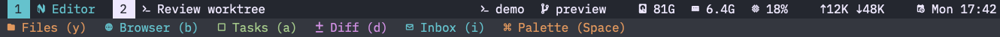

# zj-status-toolbar

A two-row Zellij bar with clickable tabs, status widgets and a toolbar. Colors
follow the active Zellij theme. Configure the contents in KDL.




## Setup

Requires Zellij 0.46.0. Build the plugin with `just wasm`, or use a compatible
WASM release if available. The build writes
`target/wasm32-wasip1/release/zj-status-toolbar.wasm`.

Copy the [example plugin alias](examples/config.kdl) into your Zellij config and
set its WASM path. Copy the [layout](examples/toolbar.kdl) to your layouts
folder and set `default_layout "toolbar"` for regular `zellij` startup. The
example uses a Nerd Font and optional commands. Keep only the entries you use.


## Configuration

The alias takes a `config` string containing KDL, in display order:

- `tabs` accepts `numbers=false` and a fallback `icon`. Its optional `icon`
  entries match a focused pane's `program` or an exact tab `title`. Set
  `active-accent` to a theme emphasis slot from 0 to 3 to change the tab accent.
- `widget` takes a `session`, `text`, or `command` source. Set `label`, `gap`,
  `max-width`, and `priority` as needed. Lower priorities drop first when space
  runs out. Command arguments are separate strings. Commands accept `every` in
  seconds and `cwd="focused"` to follow the active pane. Empty or failed results
  are hidden.
- `button "id"` takes a label, icon, optional `on-icon` and `shortcut` label,
  and an `accent` from 0 to 3. An `action` block runs standard Zellij actions. A
  `toggle` block takes one tiled `Run` with `direction "Down"` or `"Right"`. It
  closes the created pane on the next activation or when the command exits.
  Optional `grow` applies relative resize steps after opening. Use
  `action cwd="focused"` to run a command in the focused pane’s directory.

Bind a key in your chosen Zellij mode to run the same button action as a click:

```kdl
bind "y" {
    MessagePlugin "toolbar" { name "toolbar"; payload "files"; }
    SwitchToMode "Locked"
}
```

Zellij asks for permission to run the configured actions. Command widgets also
request permission to run local commands. Use a configuration you trust.


## Development

Use `just test`, `just fmt`, `just lint`, and `just wasm`.
